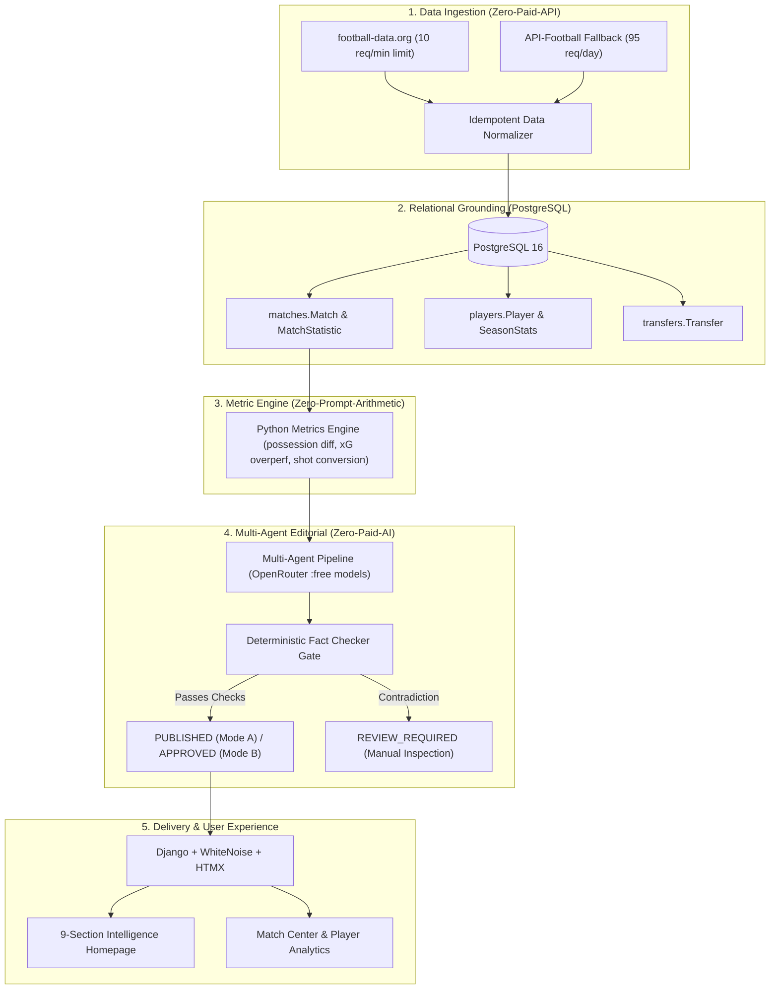

# FC Barcelona AI Football Intelligence & Editorial Platform

An autonomous, deterministic, and fact-checked football intelligence platform built for FC Barcelona supporters. Combines real-time match synchronization, pure Python pre-computation metric engines, multi-agent AI editorial pipelines, and a Blaugrana design system.

---

## 🏛️ System Architecture



---

## ⚡ Key Highlights & Constraints

1. **Zero-Paid-API Requirement**:
   - Primary data ingested from `football-data.org` with sliding-window cache rate limiting (max 10 req/60s).
   - Secondary fallback from `API-Football` (max 95 req/day).
   - Missing metrics strictly preserved as `None` (rendered as `"Unavailable"`, never fabricated).
2. **Zero-Paid-AI Requirement**:
   - Queries strictly `:free` OpenRouter models (`meta-llama/llama-3.3-70b-instruct:free`, `deepseek/deepseek-r1:free`, `qwen/qwen-2.5-72b-instruct:free`).
   - Token costs logged as `$0.00000`.
3. **Deterministic Grounding**:
   - Scorelines, goalscorers, and possession numbers in AI drafts are verified against database rows by the `DeterministicFactChecker` before publication.
4. **Blaugrana Editorial Design System**:
   - Pure CSS custom properties, semantic HTML5, and lightweight HTMX without heavy client-side frameworks.
   - Dynamic 9-section intelligence homepage and site-wide search (`/search/?q=`).

---

## 🚀 Quick Start (Local Development)

```bash
# 1. Activate environment and install dependencies
source .venv/bin/activate  # Or Windows: .venv\Scripts\activate
pip install -r requirements.txt

# 2. Run migrations
python manage.py migrate

# 3. Synchronize match data & squad
python manage.py sync_football_data --fixtures --squad

# 4. Start local development server
python manage.py runserver
```

---

## 🧪 Comprehensive Offline Test Suite

Run the full offline test suite across all applications:
```bash
python manage.py test --verbosity=2
```

All 43+ test cases execute 100% offline with zero external network dependencies, validating:
- Model relational constraints (`UniqueConstraint`).
- Sliding-window rate limiters and sync telemetry logging.
- Pure Python metrics and zero-division handling.
- OpenRouter free model fallback logic on HTTP 429/503.
- Deterministic fact-checking and automated rejection of score/stat hallucinations.
- XSS prevention on user posts and comments.
- Staff security isolation on `/customadmin/`.
- Dynamic `/sitemap.xml`, `/robots.txt`, and `/healthz/` endpoints.

---

## 🐳 Production Deployment

Refer to [`DEPLOYMENT.md`](file:///E:/Aivco/web-dev/aiv-rev/DEPLOYMENT.md) for full Docker Compose instructions, environment configuration, database disaster recovery, and Celery background workers.

